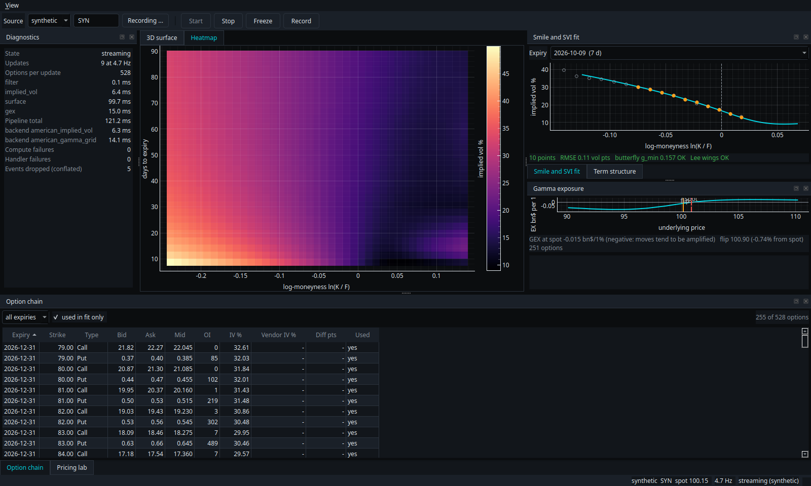
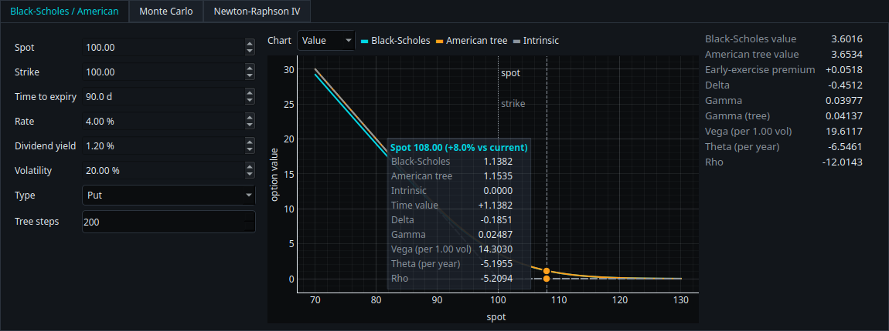
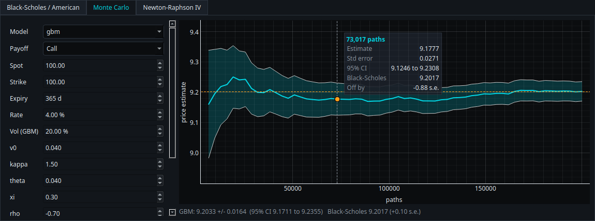
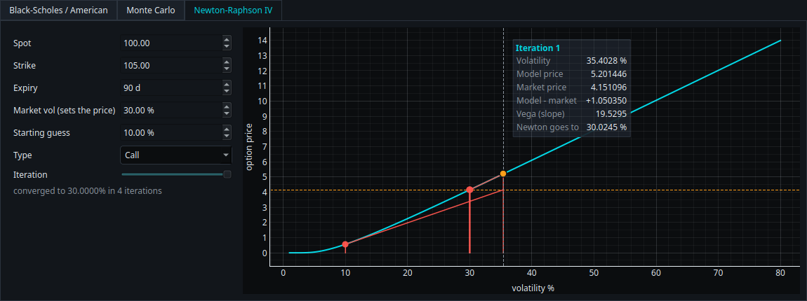

# Volsurface Desk

A desktop workstation for implied-volatility surfaces. It ingests an option chain (live from
Interactive Brokers, from a recording, or from a built-in synthetic market), solves implied
volatilities with an American-option tree, fits an arbitrage-aware SVI surface per expiry, computes
gamma exposure (GEX) with a flip level and alerts, and includes a pricing lab (Black-Scholes, the
American tree, Monte Carlo, a Newton-Raphson explorer).



*Rendered offscreen with the synthetic market. The surface panel has a 3D OpenGL tab (used on a
desktop session; it cannot render on Qt's offscreen platform) and the heatmap tab shown here.*

It is also a software-engineering showcase: a pure numerical core behind ports, an asyncio event
bus, property-based and oracle tests, enforced architecture contracts, and measured benchmarks.

## Run it (no accounts needed)

```bash
uv sync --extra ui --extra ibkr          # Python 3.13, locked dependencies
uv run volsurface gui                     # synthetic market
uv run volsurface gui --source replay:data/samples/flip   # a scripted GEX flip
```

| Command | What it does |
|---|---|
| `volsurface gui [-s SOURCE]` | the desktop application |
| `volsurface demo [-s SOURCE] [--ticks N]` | headless: print the fitted surface, arbitrage report, GEX and timings |
| `volsurface record OUT [-s SOURCE] [--seconds S]` | record a source to parquet segments |
| `volsurface bench` | time the main kernels on this machine |

A Monte Carlo notebook that ties prices to the implied-vol solver and the smile is in
`notebooks/monte_carlo.ipynb` (`uv sync --group notebooks`); the sample recordings are rebuilt with
`uv run python scripts/make_samples.py`.

Sources: `synthetic[:SYMBOL]`, `replay:/path/to/recording`, `ibkr[:SYMBOL]` (needs TWS or IB
Gateway with the API enabled; default paper port 7497, see `.env.example`).

The default source is the built-in synthetic market (symbol `SYN`, spot 100), so a plain
`volsurface gui` shows no real prices. For real SPY options, start TWS or IB Gateway, then either
pick `ibkr` in the toolbar (the symbol box switches to `SPY`) and press Start, or run
`uv run volsurface gui --source ibkr:SPY`. `VOLSURFACE_IBKR__MARKET_DATA_TYPE` selects live (1),
frozen (2), delayed (3, the default) or delayed-frozen (4) data. Per IBKR's API documentation,
delayed data is free and 15 to 20 minutes behind, and TWS keeps sending live data if the account
has a subscription, so 3 works for everyone. Type 1 on an account without a live API subscription
fails with IBKR error 10168, which the app reports and does not retry.

```text
$ uv run volsurface demo --ticks 1
SYN  2026-10-02 14:00:00 UTC  spot 100.00  528 options, 264 usable
  expiry        days   ATM vol%   RMSE vol pts  points  butterfly  Lee   rho    b
  2026-10-09      7     16.98         0.174      11  ok         ok   -0.95  0.009
  ...
  static arbitrage: none found (0 butterfly, 0 calendar)
  GEX at spot -0.029 bn$/1%   flip 101.22 (-1.20%)   256 options
  timings: filter 0.2 ms  implied_vol 30.3 ms  surface 171.6 ms  gex 34.3 ms  total 236.5 ms
```

## What is in it

| Capability | Where | Details | Docs |
|---|---|---|---|
| Black-Scholes, Greeks, implied vol | `pricing/` | vectorised; compiled safeguarded Newton; matches QuantLib | [math](docs/math/bs-and-iv.md) |
| American options | `pricing/american.py` | CRR tree in Numba, gamma, Brent IV; matches QuantLib's CRR engine to ~10 digits | [math](docs/math/crr.md) |
| SVI surface | `surface/` | weighted fit, butterfly/Lee/calendar checks, SSVI fallback, warm starts | [math](docs/math/svi.md) |
| GEX and alerts | `analytics/` | profile on an 81-point grid, flip level, three alert rules | [math](docs/math/gex.md) |
| Monte Carlo | `pricing/montecarlo/` | GBM, Heston, rainbow, Asian; bit-reproducible under threading | [math](docs/math/monte-carlo.md) |
| Market data | `marketdata/` | synthetic (ground truth), replay, IBKR (`ib_async`), recorder | [architecture](docs/architecture.md) |
| Desktop GUI | `ui/` | docked panels, 3D + heatmap, SVI smile, chain table, GEX, diagnostics, pricing lab with hover tooltips | [architecture](docs/architecture.md) |

The Pricing Lab charts respond to the mouse: hover the Black-Scholes chart (value, delta, gamma,
vega, theta or rho against spot, with the American tree and intrinsic value), the Monte Carlo
convergence plot, or the Newton-Raphson iterations to see the numbers at that point.

| Black-Scholes / American | Monte Carlo | Newton-Raphson |
|---|---|---|
|  |  |  |

## Architecture in one picture

```text
ui (PySide6 / pyqtgraph / qasync)
 └─ app (session, pipeline, commands, config, composition root)
     ├─ marketdata (synthetic | replay | ibkr)   eventing (AsyncEventBus)
     └─ analytics | surface
         └─ pricing (Black-Scholes, IV, CRR tree, Monte Carlo)
             └─ domain (value objects, events, ports)
```

Providers *push* events onto the bus; the session conflates stale chains, runs the pipeline on a
worker thread and publishes results; the window renders at a fixed rate. Layering is enforced in CI
by `import-linter`. Details, the pattern catalogue and the SOLID mapping are in
[docs/architecture.md](docs/architecture.md); decisions are recorded as [ADRs](docs/adr/README.md).

## Engineering practices

* `uv` project, `src/` layout, fully typed (`mypy --strict` on the core), `ruff` lint and format,
  `pre-commit`, GitHub Actions (lint, types, architecture contracts, tests with coverage, benchmark smoke).
* **Tests** (about 450): unit, Hypothesis properties, QuantLib oracle tests, a provider contract
  suite run against every data source, integration tests of the container and of record/replay
  determinism, and pytest-qt tests including a window running the real application.
* **Measured performance**, not claimed: [docs/benchmarks.md](docs/benchmarks.md).
* No explanatory inline comments by design; explanations live in docstrings, `docs/` and clear names.

```bash
uv run pytest                                 # everything except benchmarks
uv run pytest -m perf tests/perf --benchmark-only
uv run ruff check . && uv run ruff format --check . && uv run mypy && uv run lint-imports
```

## Honest limits

* **IBKR**: the adapter's logic (contract selection under the 100-line market-data budget,
  reconnection, snapshot building) is tested against a fake gateway, and the real `ib_async`
  gateway was written against the library's documentation, but it has **not been run against a live
  TWS** in this repository's test environment. Validate it with a paper account.
* **3D view**: the OpenGL surface cannot be exercised on Qt's offscreen platform, so tests cover its
  data preparation and the heatmap; look at the 3D tab on a desktop session.
* **GPU**: not implemented. `numba-cuda` is in maintenance mode upstream; a CUDA backend can be
  added as a plugin (see the architecture guide).
* **Data**: the synthetic market uses a smooth SSVI surface; real chains are noisier, thinner and
  stale at times. GEX uses the common "dealers long calls, short puts" convention, which is an
  assumption, not an observation.
* **Samples** in `data/samples/` are synthetic. Do not publish real broker quotes (vendor terms).

## Credits and licences

MIT licensed. Ideas and mathematics come from the sources listed in [REFERENCES.md](REFERENCES.md);
third-party notebooks are intentionally not redistributed there (licence status is documented).
