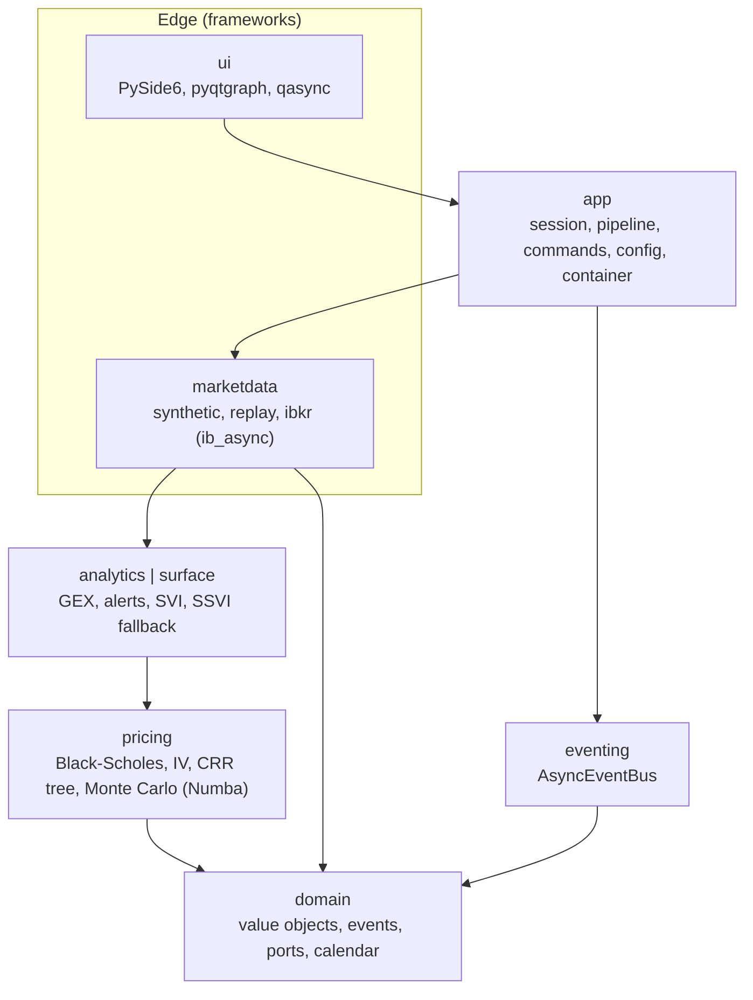
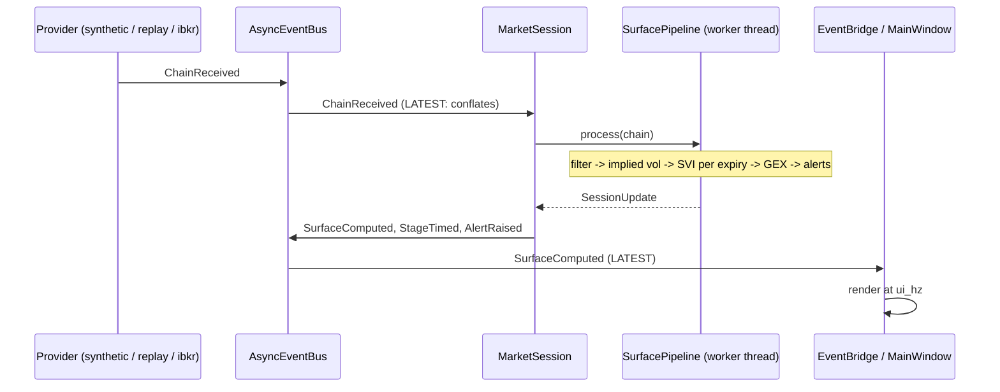

# Architecture

Volsurface Desk is a hexagonal (ports and adapters) application: a pure numerical core, adapters
at the edge, and an event bus between the parts that change at different speeds.

## Layers



The dependency rule is enforced in CI by `import-linter` (`pyproject.toml`, `[tool.importlinter]`):

1. `domain`, `pricing`, `surface`, `analytics` and `eventing` never import PySide6, pyqtgraph,
   ib_async, qasync or OpenGL.
2. Layers only import downwards: `ui` > `app` > `marketdata | eventing` > `analytics | surface` >
   `pricing` > `domain`.
3. `ui` never imports `marketdata`; it reaches sources through `app.sources`.

## Data flow of one update



* A provider **pushes** immutable `ChainReceived` events. Nothing polls.
* The session subscribes with the `LATEST` policy, so if the pipeline is slower than the feed it
  skips stale chains instead of falling behind. Dropped events are counted and shown in the
  diagnostics panel.
* The pipeline is CPU-bound, so it runs on a worker thread (`asyncio.to_thread`). Compiled kernels
  release the GIL and use all cores; a process-wide lock serialises parallel regions because
  Numba's `workqueue` threading layer cannot run two at once.
* The window renders the newest update at a fixed rate (`ui_hz`), independent of how fast updates
  arrive.

## Event catalogue

| Event | Layer | Published by | Consumed by |
|---|---|---|---|
| `ChainReceived`, `SpotTicked`, `ConnectionStateChanged` | domain | providers | session, recorder |
| `HandlerFailed` | domain | the bus | diagnostics, UI |
| `SurfaceComputed`, `AlertRaised`, `StageTimed`, `ComputeFailed`, `SessionStateChanged` | app | session, container | UI bridge, diagnostics |

User intents are **commands** (`StartSession`, `StopSession`, `Freeze`, `Resume`, `SetRecording`),
each handled by exactly one function registered with the `CommandDispatcher`. The GUI, the CLI and
the tests all drive the application through that vocabulary.

## Event bus semantics

`AsyncEventBus` (`src/volsurface/eventing/bus.py`) is deliberately small and has no dependencies:

* subscribe by event class; a subscription to a base class also receives subclasses;
* one mailbox and one task per subscription, so subscribers cannot slow each other down and each
  one sees events in publish order;
* `QUEUED` (bounded FIFO, drops the oldest on overflow) or `LATEST` (keeps only the newest);
* a failing handler is logged and republished as `HandlerFailed`; it never reaches the publisher,
  and a failing `HandlerFailed` handler cannot loop;
* `drain()` waits until every queued event, including those published by handlers, was handled,
  which makes asynchronous tests deterministic.

Libraries were checked before writing it (see ADR 0002): none combined per-subscriber
conflation, bounded queues, error isolation and a record/replay tap.

## Record and replay

The event log is the recording. `EventRecorder` is an ordinary subscriber that writes every
`ChainReceived` to parquet segments; `ReplayProvider` publishes the same events back. Downstream
code cannot tell live from replayed data, and `tests/integration/test_record_replay_determinism.py`
asserts that replaying a recording reproduces the surfaces and GEX profiles exactly.

## Design patterns, and the problem each one solves

| Pattern | Where | Problem solved |
|---|---|---|
| Observer / publish-subscribe | `eventing.AsyncEventBus` | producers and consumers do not know each other; a new feature is a new subscriber |
| Ports and adapters (anti-corruption layer) | `domain.ports`, `marketdata.*` | the core never sees IBKR or Qt types |
| Strategy | `PricingBackend`, `PathModel`, `QuoteSpec`, alert rules | swap algorithms without touching callers |
| Registry + Factory (+ entry points) | `pricing.backends`, `marketdata.factory` | a GPU backend can register itself as a plugin |
| Specification | `pricing.quote_filter` | quote rules compose with `&`, `\|`, `~` instead of nested ifs |
| Decorator | `TimedBackend` | timing around any backend without changing it |
| State machine | `app.session_state` | guarded lifecycle transitions (`IllegalTransitionError`) |
| Command | `app.commands` | UI and CLI actions as testable objects |
| Template Method + Strategy | `montecarlo.engine` | one statistics pipeline, pluggable stochastic model |
| Builder | `surface.builder` | a long construction procedure behind a fluent, validated interface |
| Repository | `marketdata.recording_store` | parquet layout hidden behind `read` / `write_all` |
| Null Object | `NullPublisher`, `NullRecorder`, `AcceptAll` | removes `if x is None` branches |
| Dependency injection (composition root) | `app.container` | constructor injection by hand, `AsyncExitStack` for ordered shutdown |
| Value objects | `domain.types` | frozen, validating dataclasses; read-only numpy columns |

Patterns that have no trigger in this application (Singleton, Visitor, Flyweight, a DI framework)
are intentionally absent.

## SOLID, concretely

* **S**: one reason to change per module. `svi.py` is the model, `svi_fit.py` the calibration,
  `arbitrage.py` the checks.
* **O**: a new provider, pricing backend, quote rule, alert rule or subscriber is added without
  editing existing code.
* **L**: `tests/contract/test_market_data_provider_contract.py` runs the same assertions against
  every `MarketDataProvider` (synthetic, replay, IBKR with a fake gateway).
* **I**: small protocols (`EventPublisher`, `EventSubscriber`, `Subscription`, `Recorder`,
  `BrokerGateway`) instead of one large interface.
* **D**: the core depends on ports; the composition root wires adapters.

## Testing strategy

| Kind | Where | What it proves |
|---|---|---|
| Unit | `tests/unit` | behaviour of each module in isolation |
| Property (Hypothesis) | `tests/property`, parts of `tests/unit` | invariants over wide input ranges (put-call parity, IV round trip, bus ordering, SSVI is always butterfly-free) |
| Oracle | marked `oracle` | agreement with QuantLib (Black-Scholes and the CRR tree) |
| Contract | `tests/contract` | providers are interchangeable |
| Integration | `tests/integration` | container, session, recording and replay end to end |
| UI (pytest-qt, offscreen) | `tests/ui` | widgets and a full window running the real application |
| Performance | `tests/perf` (`-m perf`) | the numbers in [benchmarks.md](benchmarks.md) |

The OpenGL 3D view cannot run on Qt's offscreen platform, so its data preparation
(`viewmodels.surface_gl_arrays`) is tested and the widget degrades to the heatmap tab where OpenGL
is unavailable.

## Extending

* **New data source**: implement `MarketDataProvider` (`start`, `stop`, `name`), register a
  builder in `marketdata.factory`, add it to the contract test parameters.
* **New pricing backend** (for example CUDA): implement `PricingBackend` and advertise it in
  another package's `pyproject.toml`:

  ```toml
  [project.entry-points."volsurface.pricing_backends"]
  numba-cuda = "my_package.backend:CudaBackend"
  ```

  It then appears in `BackendRegistry` and is selected with `VOLSURFACE_BACKEND=numba-cuda`.
* **New alert**: implement `AlertRule.evaluate` and add it to `AlertEngine`.
